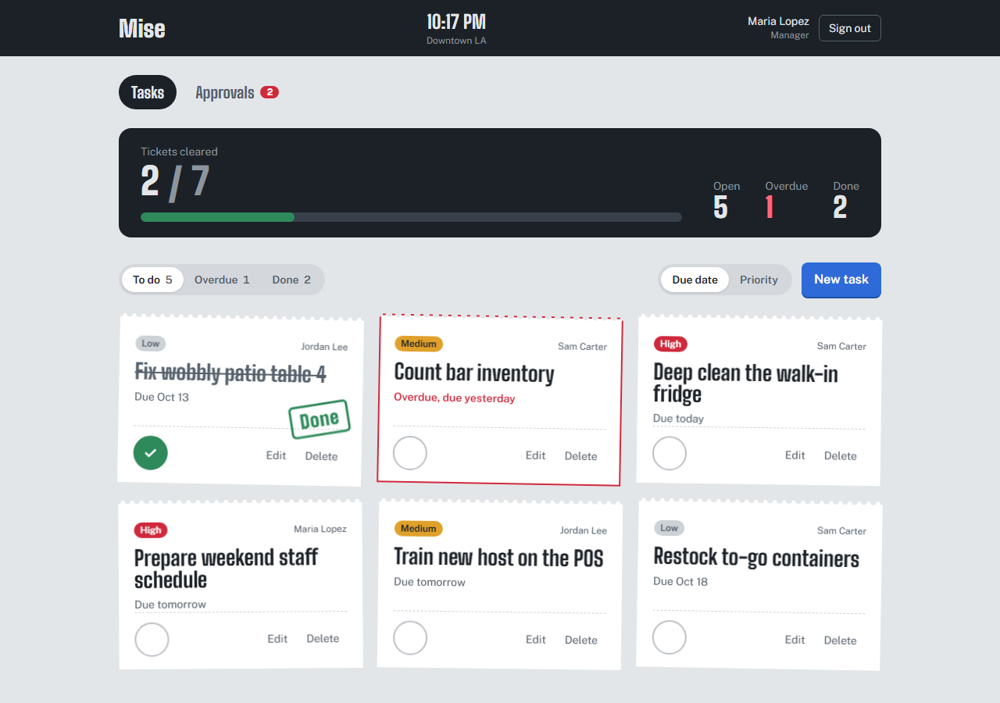
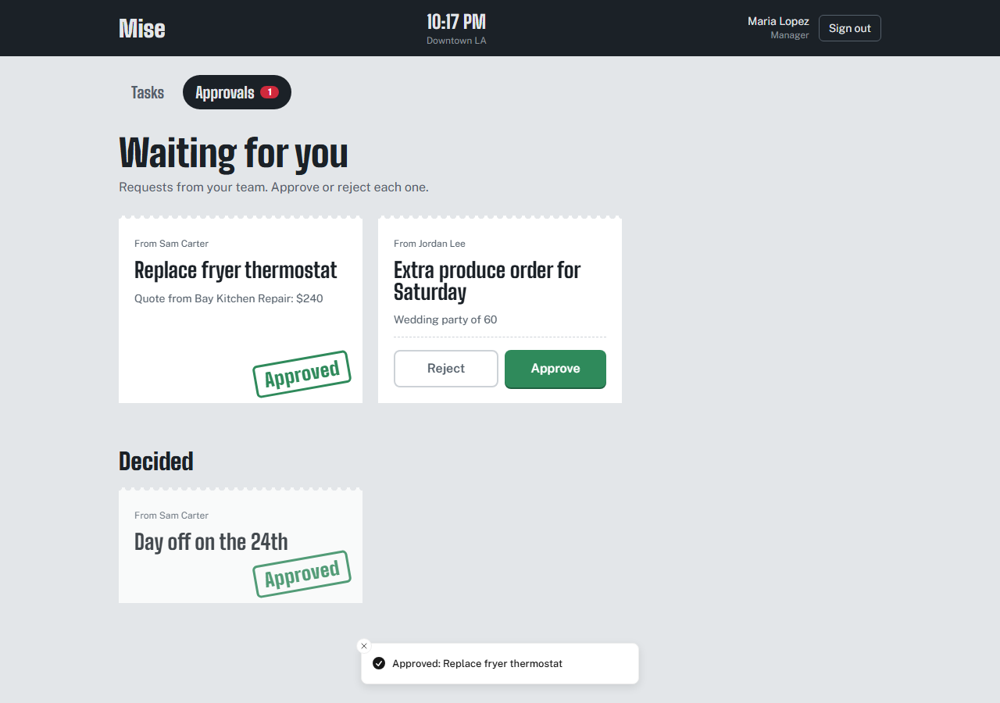
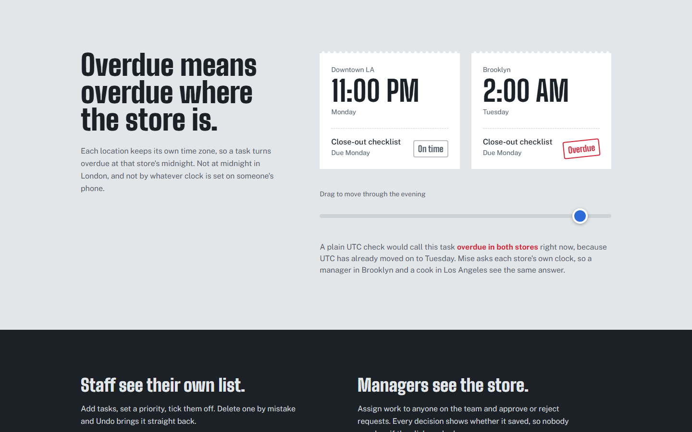

# Mise

Tasks and approvals for restaurant teams working across several locations.

> _Mise en place_: everything in its place before service starts.

**Live demo: [mise-tasks.vercel.app](https://mise-tasks.vercel.app)**. Pick a demo account on the sign-in page:

| Account       | Sees                                                             |
| ------------- | ---------------------------------------------------------------- |
| Store manager | The whole Downtown LA store; assigns tasks and approves requests |
| Staff member  | Only their own tasks and requests                                |



## What it does

- **Tasks as tickets.** Each task has a priority and a due date. Finishing one stamps it Done, and a scoreboard tracks how much of the shift is cleared. Deleting a task removes it straight away, with Undo.
- **Overdue in the store's time zone.** A task turns overdue at midnight where the store is, never in UTC and never by the viewer's device clock. A manager in Brooklyn and a cook in Los Angeles see the same answer.
- **Approvals.** Staff send requests (supplies, repairs, time off). Their store's manager approves or rejects them, and every decision visibly confirms that it saved.
- **Roles enforced by the database.** Managers see their whole store; staff see only their own work. The Firestore security rules enforce this, not just the interface, and the rules have their own test suite.

| Approvals                                    | Overdue across time zones                          |
| -------------------------------------------- | -------------------------------------------------- |
|  |  |

## Stack

|               |                                                                   |
| ------------- | ----------------------------------------------------------------- |
| App           | Next.js 16 (App Router), React 19, TypeScript (strict)            |
| Data and auth | Firebase Auth, Cloud Firestore, security rules                    |
| UI            | Tailwind CSS 4, Motion, Lenis, Sonner                             |
| Tests         | Vitest (unit), Firestore emulator (security rules)                |
| CI            | GitHub Actions: format, lint, typecheck, unit tests, build, rules |
| Hosting       | Vercel (production on `main`, a preview for every pull request)   |

Everything runs on free tiers.

## How it's built

**Firebase runs in the browser only.** Pages are prerendered as static shells, and the Firebase SDK starts lazily on first use. So the build needs no Firebase config, and no server holds admin credentials.

**The security rules are the security boundary.** Route guards in the UI only decide what to show. What anyone can _read or write_ is decided in [`firestore.rules`](firestore.rules):

- A user's role and store come from their profile document, which only the server can write. Nobody can promote themselves to manager.
- Staff can read and change only their own tasks. Managers can do so across their own store, and can assign tasks only to people in it.
- Nobody can move a task to another owner or store by editing it.
- A request is created as `pending` with only the expected fields. Only that store's manager can decide it, only once, and only the decision fields can change.

[`tests/rules`](tests/rules/firestore.rules.test.ts) checks each of these against the emulator. When the suite was first written, 16 of its 22 tests failed against the classic "any signed-in user can read and write" rule.

**Data model.**

```
stores/{storeId}   name, timeZone            // e.g. "America/Los_Angeles"
users/{uid}        name, role, storeId       // written by the server only
tasks/{taskId}     title, ownerId, storeId, dueDate ("YYYY-MM-DD"), priority, done
approvals/{id}     title, details?, requesterId, storeId, status, createdAt,
                   decidedBy?, decidedAt?
```

**Time zones.** `dueDate` is a calendar date in the store's zone. [`isOverdue()`](src/lib/dates.ts) compares it to _today in the store's time zone_. The unit tests include the case that motivated it: 8 PM in Los Angeles, when the UTC date is already tomorrow.

**Live data and honest feedback.**

- Lists are live Firestore queries scoped to exactly what the rules allow.
- A delete shows straight away (Firestore applies it locally first) and offers Undo. If the server rejects it, the task comes back with an error.
- Approve and Reject run in a transaction. A transaction only resolves once the server accepts it, so the button never reports a success that didn't happen. If two managers decide at once, the second gets "already approved" instead of a silent overwrite.

**Design.** The look comes from a kitchen's ticket rail: steel, ticket paper and ink. Red is reserved for overdue and high priority. Motion supplies the ticket drops, stamps and rolling counters. Reduced-motion settings are respected throughout.

## Running locally

You need Node 24 and Java 21 (for the Firebase emulators). No Firebase account is needed: everything runs against local emulators with demo data.

```bash
npm install
cp .env.example .env.local          # then set NEXT_PUBLIC_USE_FIREBASE_EMULATORS=true

npm run emulators                   # terminal 1: Auth + Firestore emulators
npm run seed:emulator               # terminal 2: demo stores, accounts, tasks
npm run dev                         # http://localhost:3000
```

| Script               |                                                  |
| -------------------- | ------------------------------------------------ |
| `npm run lint`       | ESLint                                           |
| `npm run typecheck`  | Generates Next route types, then `tsc`           |
| `npm test`           | Unit tests                                       |
| `npm run test:rules` | Firestore security rules tests (emulator)        |
| `npm run seed`       | Reset demo data in the real project (admin only) |
| `npm run format`     | Prettier                                         |

## How I work on this repo

Every change starts as an [issue](https://github.com/EmilioYared/mise/issues?q=is%3Aissue), goes on its own branch, and is merged through a [pull request](https://github.com/EmilioYared/mise/pulls?q=is%3Apr) once CI passes. Each PR explains what changed and how it was checked. Commits are small and use conventional messages (`feat(tasks): …`, `fix(rules): …`). Vercel builds a preview of every PR, so it can be tried before it merges.
